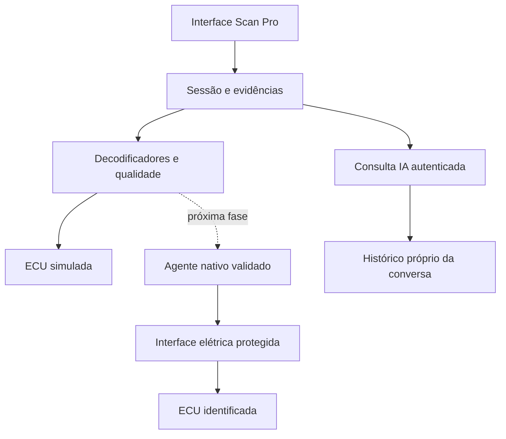

# Scan Pro — arquitetura e contrato de expansão

## Fronteiras



O navegador não deve operar diretamente uma DLL RP1210/J2534 nem receber uma chave `service_role`. O agente local futuro implementará o transporte nativo, filas de leitura, timeouts e capacidades. O aplicativo recebe pacotes normalizados; os decodificadores não conhecem a interface visual.

## Componentes atuais

| Arquivo | Responsabilidade |
|---|---|
| `scan-pro/protocols.mjs` | Validação de bytes e pacotes; OBD-II, J1939, ISO-TP e respostas UDS |
| `scan-pro/simulator.mjs` | Perfis, cenários, quadros virtuais, sinais didáticos e bloqueio físico |
| `scan-pro/recordings.mjs` | Formato versionado, procedência, limites, IndexedDB e CSV |
| `scan-pro/assistant.mjs` | Contexto selecionado, roteiro por regras e cliente SSE autenticado |
| `scan-pro/app.mjs` | Interface, sessão local, gráficos e transições de escopo |
| `oficina360-scan-pro-entry.js` | Entrada adicional no Oficina, preservando o veículo selecionado |
| `supabase/functions/oficina360-scan-pro-ai` | Consulta OpenAI, autenticação e histórico com RLS |

## Amostra v1

```json
{
  "schema": "o360.scan.sample.v1",
  "simulated": true,
  "origin": "simulation",
  "profile": "comil",
  "protocol": "j1939",
  "sequence": 0,
  "recorded_at": "2026-10-27T12:00:00.000Z",
  "state": "streaming",
  "pids": {
    "engine_rpm": {"value": 1500, "unit": "rpm", "quality": "simulated", "source": "decoder_lab"}
  },
  "dtcs": [],
  "frames": [{"protocol":"j1939", "id":217056256, "data":[255,255,255,224,46,255,255,255]}]
}
```

O formato de gravação `o360.scan.recording.v1` contém identificação, perfil, horário de início, amostras e eventos. Só dados marcados como laboratório são aceitos pelo importador. Um futuro contrato físico deve ter versão e validação próprias; não remover `simulated` nem rebatizar uma simulação como leitura real.

Unidades canônicas: rpm, °C, V, km/h, %, kPa absolutos, g/s e bar. Não misturar pressão absoluta com manométrica. `source=didactic_model` indica sinal matemático sem mapeamento OEM. `state=timeout` exige ausência de sinais e DTCs atuais; não preencher com o último valor conhecido.

## Cobertura implementada

| Família | Implementado | Fora da versão atual |
|---|---|---|
| OBD-II | Respostas Mode 01 PIDs 04/05/0B/0C/0D/0F/10/42; DTC Mode 03 | Descoberta física, freeze frame, Mode 06, readiness completo, códigos OEM |
| J1939 | EEC1/SPN190, ET1/SPN110, CCVS1/SPN84, DM1 CM=0 de um quadro | TP/BAM/RTS-CTS, DM2/DM3, mensagens proprietárias, address claiming |
| ISO-TP | Receptor clássico, normal addressing, comprimento de 12 bits, múltiplos canais, sequência e timeout | Emissão FC física, CAN-FD, extended/mixed addressing e driver |
| UDS | Resposta de leitura F190, negativa e pending NRC78 | Sessões OEM, security access, routines, IO control, flash e DIDs proprietários |
| KWP/K-Line | Registro de capacidade planejada | Inicialização elétrica, transporte e serviços OEM |
| J1708/J1587 | Registro de capacidade planejada | Interface elétrica e implementação |
| Mecânico | Exercícios de medição manual | ECU de motor quando ela não existe |

## Transporte profissional futuro

`ProfessionalTransport` é uma fronteira explícita e bloqueada: `connect()` informa que falta driver/hardware; qualquer pedido de escrita falha. Informar `{actuator:true}` numa instância não habilita comando físico nesta versão.

O agente nativo futuro precisa cumprir:

1. Identificar interface, versão de driver, ECU, endereço, tensão e protocolo. Capacidades devem ser negadas por padrão.
2. Fazer handshake com nonce e token de curta duração, ligado ao usuário/empresa/veículo. Validar origem e autenticação de qualquer conexão local; não abrir WebSocket público sem autenticação.
3. Usar números de sequência, horários de captura/recebimento separados, timeout, mensagens limitadas e buffer de retorno.
4. Manter cancelamento e desconexão por sessão; não executar fila de comandos antigos após reconectar.
5. Declarar capacidades por ECU/serviço/versão: leitura, DTC, teste específico, codificação ou flash. Suporte de protocolo não equivale a suporte de função OEM.
6. Antes de um atuador real: documentação aplicável, permissões, identificação confirmada, pré-condições do fabricante, confirmação do operador, timeout e parada/cancelamento. Nunca permitir comando arbitrário originado na IA.
7. Registrar requisição, resultado, origem, usuário e motivo de bloqueio. A IA consulta evidências; o executor nativo decide se uma capacidade validada pode ser oferecida ao operador.

Não estão implementados desbloqueios, evasão de security access, bypass de imobilizador, redefinição de emissões, flash ou banco de rotinas licenciado. Quando alguma função legítima exigir licença/OEM, isso deve permanecer visível na matriz de cobertura.

## Fases e compra do hardware

| Fase | Critério de saída | Compra |
|---|---|---|
| 0 — laboratório | Simulação, gravação, falhas e conversa verificadas | Nenhuma necessária |
| 1 — identificação | Fotos e dados de ECU/conector/tensão de cada condução; protocolos confirmados | Instrumentação de conferência, se faltar |
| 2 — bancada | Driver documentado, proteção elétrica e leitura em banco | Interface + cabos adequados |
| 3 — frota, somente leitura | Valores comparados com instrumento/scanner de referência e evidência rastreável | Complementos após identificar lacunas |
| 4 — funções avançadas | Cada rotina validada individualmente por ECU e pré-condições | Interfaces/licenças específicas, quando necessárias |

Reserva de R$ 10 mil exclusivamente para equipamento. Antes de cotar, confirmar a interface suportada e a alimentação. Categorias a avaliar: VCI com SDK documentado e proteção 12/24 V, cabos/derivações corretos, breakout protegido, multímetro, instrumentação de sinais e computador/tablet de bancada caso não exista. Esta entrega não é uma cotação nem recomenda comprar um VCI por semelhança de conector. Não atribuir o custo do software ou da OpenAI ao teto de hardware.

## Execução e publicação

Aplicação estática: servir a raiz do repositório por HTTP e abrir `/scan-pro/index.html`. No domínio real, a entrada pelo menu do Oficina acrescenta o UUID da condução e reutiliza a sessão existente. Abrir em outro domínio não transfere autenticação.

Testes novos: `node --test qa/scan-pro-*.test.mjs` com Node 24. A publicação do serviço isolado precisa incluir `index.ts`, `contract.ts`, `_shared/openai-server.ts` e `_shared/assistant-stream.ts`, preservando os imports relativos e JWT obrigatório. Nenhuma migration necessária. Não republicar `controla-ai` para instalar este módulo.

Rollback da interface: reverter a alteração de duas linhas em `oficina360.html` e remover o script de entrada; os módulos antigos continuam funcionando. O endpoint isolado pode permanecer sem consumidores ou ser desativado no processo de administração. Gravações locais são independentes; conversas não devem ser excluídas para fazer rollback.
